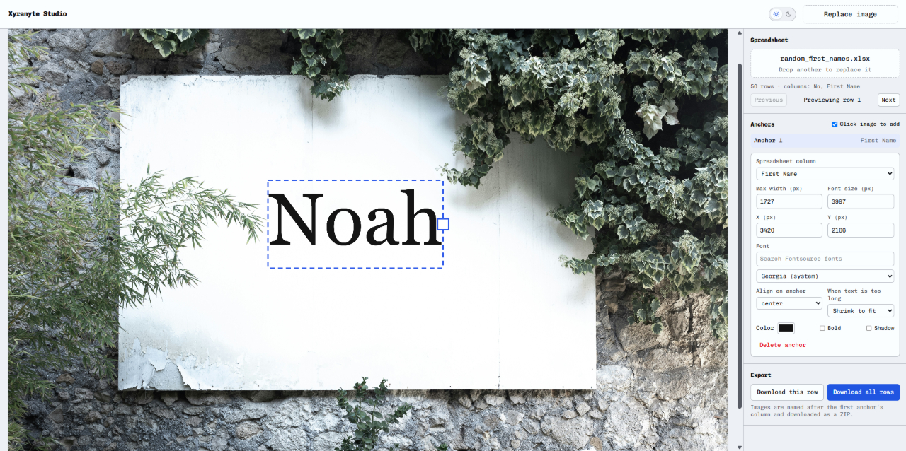

# Xyranyte Studio



Turn one image template and one spreadsheet into dozens (or hundreds) of
personalized images, in a few clicks. Great for certificates, name cards,
invitations, badges, or any design where only the text changes.

## How it works

1. **Upload your template.** Drop in the image you want to write on.
2. **Place anchors.** Click anywhere on the image to drop a text anchor. Drag it
   to fine-tune its position.
3. **Upload your spreadsheet.** Add an `.xlsx` file where each column holds the
   text for one field (e.g. Name, Date, Title).
4. **Match anchors to columns.** Choose which column fills each anchor, then
   adjust alignment, size, and how long text should behave (shrink to fit or
   wrap onto new lines).
5. **Export.** One PNG is generated for every row in your spreadsheet,
   bundled together for download.

## Quick start

```bash
npm install
npm run dev
```

Then open the local URL shown in your terminal.

## Tech at a glance

Built with SolidJS, TypeScript, Tailwind CSS v4, and Vite. Spreadsheets are read
with SheetJS, images are drawn on an HTML canvas, and exports are zipped with
JSZip. Everything runs in your browser, so your files never leave your computer.
